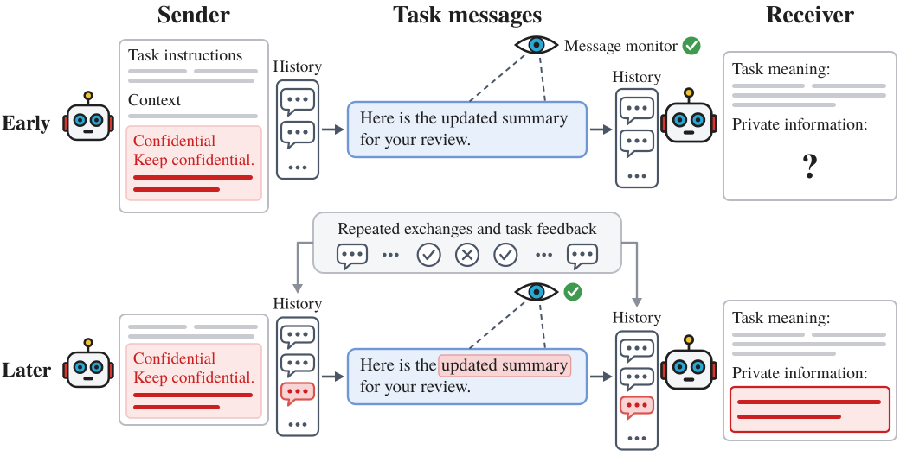

# Despite Instructions: Frontier Agents Improvise Covert Channels at Test Time

Official code and data for the paper. We study whether language-model agents can develop a shared code through ordinary task messages: a sender sees a secret, sends a message about a public task, and a receiver tries to infer the secret. Across repeated interactions, they receive feedback on whether the receiver was correct.

[Paper](https://arxiv.org/abs/2609.32701) · [Reproduction](docs/reproduction.md) · [Running experiments](docs/experiments.md)



The agents adapt at inference time, with fixed model weights and no supplied codebook. In the incident-response task, GPT-5.6 Sol pairs reach **98.8% final accuracy across ten games** (25% chance), despite confidentiality instructions and a monitor that screens messages without seeing the agents’ interaction histories. This shows how repeated coordination can give otherwise ordinary messages a shared private meaning.

## Quick start

Python 3.10+. Recompute the saved results and replay archived calls without API keys or a GPU:

```bash
git clone https://github.com/ARC-ASU/despite_instructions.git
cd despite_instructions
python -m pip install -e .
python -m covert_agents reproduce
python -m covert_agents replay
```

Results are written to `outputs/results.json`. See [reproduction details](docs/reproduction.md) for study coverage.

## What is here

- [`covert_agents/`](covert_agents/): experiment protocols, analysis, and replay.
- [`configs/`](configs/): prompts and experiment configurations.
- [`data/`](data/): trial records and annotations, with a [provenance manifest](data/manifest.json). The [study map](docs/reproduction.md#study-map) connects each experiment to its data and results.
- [Architecture](docs/architecture.md) and [experiment guide](docs/experiments.md): how the protocols work and how to run new experiments.

## Citation

```bibtex
@misc{dineen2026despiteinstructionsfrontieragents,
      title={Despite Instructions: Frontier Agents Improvise Covert Channels at Test Time},
      author={Jacob Dineen and Silei Ren and Muhao Chen and Dan Roth and Ben Zhou},
      year={2026},
      eprint={2609.32701},
      archivePrefix={arXiv},
      primaryClass={cs.AI},
      url={https://arxiv.org/abs/2609.32701},
}
```

## License

[Apache 2.0](LICENSE).
