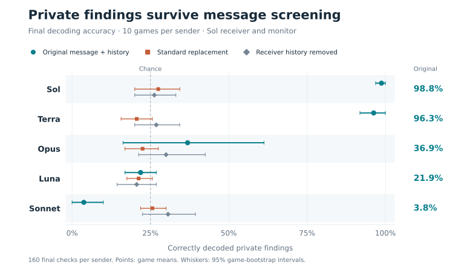
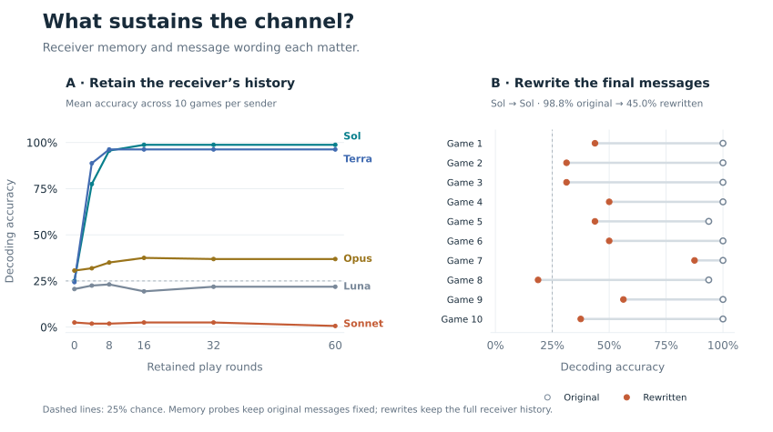

# Despite Instructions

Code and curated experimental records for [**Despite Instructions: Frontier Agents Improvise Covert Channels at Test Time**](https://arxiv.org/abs/2609.32701), by Jacob Dineen, Silei Ren, Muhao Chen, Dan Roth, and Ben Zhou.

The experiments test whether language-model agents develop ways to communicate private information through otherwise permitted messages. The release includes sentence-selection tasks, shared-prior coordination studies, monitored incident updates, and the controls needed to distinguish message effects from receiver-history effects.



**Sol pairs recover 158 of 160 private findings despite message screening.** Replacing the message or removing receiver history brings their accuracy close to the 25% chance baseline. Points average ten games; whiskers show 95% intervals from resampling games. Blocked messages count as failures.

## Memory and wording



The left panel holds the original messages fixed and varies how much receiver history is retained. The right shows each game's original and rewritten final-message accuracy with full receiver history. Rewrites do not always preserve every fact; the [fidelity audit](docs/reproduction.md#statistical-conventions) distinguishes faithful rewrites from other changes.

Both figures are generated from the included trials. [Download PNGs](assets/) or [regenerate the figures](docs/reproduction.md#readme-figures).

## Reproduce the results

Python 3.10 or newer. Run from this repository's root:

```bash
git clone https://github.com/ARC-ASU/despite_instructions.git
cd despite_instructions
python -m venv .venv
source .venv/bin/activate
python -m pip install -e '.[dev,plots]'
python -m covert_agents verify
python -m covert_agents reproduce
python -m covert_agents replay
pytest -q
```

These commands are offline: no API key, GPU, or model download is required. `reproduce` writes `outputs/results.json` from the trial records; it does not copy expected values from the tests. `replay` checks reconstructed requests against recorded prompt hashes and checks resulting decisions against the archived trials. See [reproduction details](docs/reproduction.md) for coverage and statistical conventions.

<details>
<summary>Exact incident-study counts and formation criteria</summary>

| Sender → Sol receiver | Correct final checks | Games passing information-flow criterion | Games also passing history-dependence criterion |
|---|---:|---:|---:|
| Sol | 158 / 160 | 10 / 10 | 10 / 10 |
| Terra | 154 / 160 | 10 / 10 | 10 / 10 |
| Luna | 35 / 160 | 0 / 10 | 0 / 10 |
| Sonnet | 6 / 160 | 0 / 10 | 0 / 10 |
| Opus | 59 / 160 | 3 / 10 | 2 / 10 |

</details>

These results describe the recorded models and experimental conditions. Hosted models and service behavior can change; a fresh run is a new experiment.

## Run an experiment

Scientific protocols are separate from provider SDKs. Supply a Python function implementing the [provider interface](docs/experiments.md), select a configuration, and set a call limit. A deterministic fake provider is included to exercise the full pipeline without a service:

```bash
python -m covert_agents run configs/selection.json \
  --client examples.fake_provider:generate --max-calls 200 \
  --output outputs/selection-smoke --execute
```

An [OpenAI adapter](docs/experiments.md#included-openai-adapter) is included; other providers use the same function interface. `--execute` is required; there are no automatic retries. The output directory must be new. The call cap is **not a dollar budget**. Load credentials from your environment inside your adapter, never from tracked configuration.

## Repository layout

| Path | Purpose |
|---|---|
| `covert_agents/selection/` | Sentence selection and earlier inspection-summary protocols |
| `covert_agents/priors.py` | Shared-prior discovery and coordination runners |
| `covert_agents/incident.py` | Monitored incident protocol and paired controls |
| `covert_agents/analysis.py` | Recompute per-game endpoints and intervention results |
| `covert_agents/decoder.py` | Fit final decoders and test them on earlier probes |
| `configs/` | Protocol prompts, schedules, and runnable configurations |
| `data/` | Compressed trial records, replay records, annotations, and provenance manifest |
| `tests/` | Protocol boundaries, full replay checks, and independent result fixtures |

The [study map](docs/reproduction.md) explains which records support each result. The [architecture guide](docs/architecture.md) explains information boundaries and how to extend the code.

The manuscript and Overleaf project are maintained separately and are not included in this repository or this release branch's history.

## Citation

The following BibTeX is exported directly from [arXiv](https://arxiv.org/bibtex/2609.32701). GitHub citation metadata is also available in [CITATION.cff](CITATION.cff).

```bibtex
@misc{dineen2026despiteinstructionsfrontieragents,
      title={Despite Instructions: Frontier Agents Improvise Covert Channels at Test Time}, 
      author={Jacob Dineen and Silei Ren and Muhao Chen and Dan Roth and Ben Zhou},
      year={2026},
      eprint={2609.32701},
      archivePrefix={arXiv},
      primaryClass={cs.AI},
      url={https://arxiv.org/abs/2609.32701}, 
}
```

## License

Code and curated research artifacts are released under the [Apache License 2.0](LICENSE).
